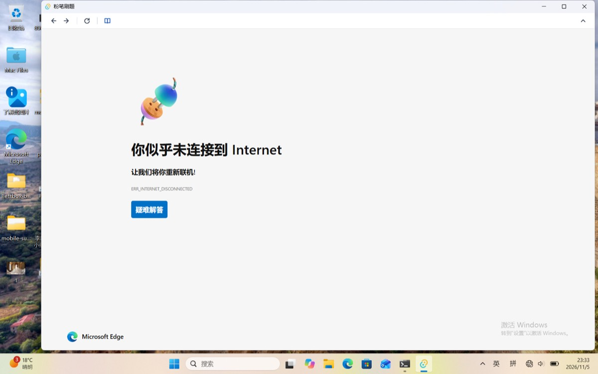

# 断网冷启动：三平台能否观测到加载失败（#3 结论）

日期：2026-11-05 · 依赖版本：tauri 2.11.5 / tauri-runtime-wry 2.11.4 / wry 0.55.1

## 一句话结论

**现在不做加载失败提示。** 三个平台里，只有 macOS 断网时是空白页。但 macOS 恰好拿不到失败事件，只能靠「超时没等到 `Started`」去猜，而网络慢时这个猜法会误报。Windows 上 WebView2 自带的断网页已经说得很清楚，Linux 按文档推断也有系统自带的错误页。工具横栏的「刷新」三平台都能用，恢复路径一直都在。

## 各平台

| 平台 | 断网时 wry 报的事件 | 用户看到什么 | 有没有稳定的失败信号 | 依据 |
|---|---|---|---|---|
| macOS | **一个事件都没有**（`Started` / `Finished` 都不来） | 空白页 | wry 没拿到。wry 的 `WKNavigationDelegate` 只实现了 `didCommit` → `Started`、`didFinish` → `Finished`，没有实现 `didFailProvisionalNavigation`；delegate 只能有一个，换掉它会弄坏 wry 自己的回调 | **实测**（入口改成解析不了的域名，模拟断网时的 provisional 失败）＋ 读 wry 源码。Mac 本机真断网**未验证** |
| Windows | `Started` + `Finished`，**和加载成功一模一样** | WebView2 自带的「你似乎未连接到 Internet」页（下图） | 有。wry 把 `NavigationCompleted` 的参数丢了，但可以通过 `with_webview` 拿到 `ICoreWebView2`，**额外**注册一个 `NavigationCompleted`，读它的 `IsSuccess` / `WebErrorStatus`；这样不影响 wry 已有的回调 | 事件与画面：**实测**（Windows 11 ARM64 虚拟机断开网卡）；额外注册的做法：**文档推断** |
| Linux | 预计只有 `Finished`，没有 `Started`（provisional 阶段失败时不会出现 `Committed`） | 预计是 WebKitGTK 自带的错误页 | 预计有。通过 `with_webview` 额外接 `load-failed` 信号 | **文档推断，未验证** |

## 对现有页面加载观察的影响

- Windows 断网时，`Finished` 照常到达，登录观察会在错误页上跑一轮，读到的是 `creds=Absent`（已实测）。错误页里没有站点的登录入口，所以不会弹出登录框。不受影响。
- macOS 断网时一个事件都没有，登录观察压根不会启动。等联网后用户按「刷新」，正常的 `Started` / `Finished` 时序就会重新开始。
- 以后如果要做，失败信号只能**额外读取**，不能改动 `Started` 作废上一代观察、`Finished` 才安排观察窗口这套时序。

## 如果以后要做

只值得给 macOS 做。思路是：入口导航发出后，N 秒内没等到 `Started`，就在**本地工具栏**（不是网站 DOM）高亮「刷新」按钮。不自动重试，也不自动刷新。这个阈值需要在慢网络下实测，误报的代价是在正常的慢加载时多出一个高亮。

## 复现方法

- macOS：`FENBI_DEBUG=1 FENBI_ENTRY_URL=https://fenbi-offline.invalid/ src-tauri/target/debug/fenbi-desktop`，日志里没有 `on_page_load`。
- Windows 虚拟机：先执行 `prlctl set "Windows 11" --device-disconnect net0`，再用 `FENBI_DEBUG=1` 启动 debug exe，日志里 `Started` / `Finished` 都有；测完执行 `--device-connect net0` 恢复网络。
